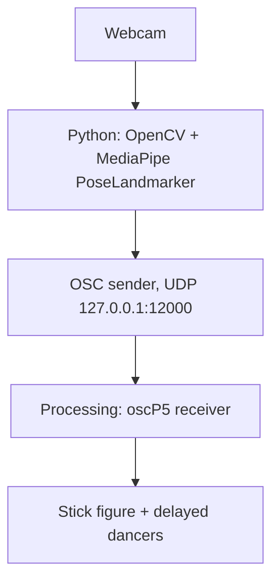

# Stick Figure Dance Company (Webcam + MediaPipe)

Webcam-based adaptation of Project 2 ("Stick Figure Dance Company") from the book
*Processing 2: Creative Coding Hotshot* by Nikolaus Gradwohl. The original project
uses a Kinect; this version uses a normal webcam and MediaPipe Pose instead
(approved by the lecturer). A Python program tracks your body, streams the joint
positions over OSC, and a Processing sketch draws you as a stick figure plus a
"company" of delayed, smaller, colored copies.

## Status

| Part | State |
|------|-------|
| OSC link Python -> Processing | Done (`vision/osc_dummy.py`, `processing/OscTest`) |
| Pose tracking with MediaPipe | Done (`vision/main.py`) |
| Stick figure rendering | Done |
| Multi-dancer "company" (delayed copies) | Done |
| Hand-gesture interaction + audio | Not started |
| Latency / lighting tests, demo GIF | Not started |

## Architecture



Both programs run on the same machine. Python must run AFTER Processing is started.

## Requirements

- A webcam
- Python 3.9 (developed and tested on 3.9; other versions untested)
- Processing 4 with the **oscP5** library
  (Sketch > Import Library > Manage Libraries > search "oscP5" > Install)

## Setup

macOS / Linux:

```bash
git clone https://github.com/mhmdjefr/stick-figure-dance-company.git
cd stick-figure-dance-company
python3 -m venv .venv
source .venv/bin/activate
pip install -r vision/requirements.txt

mkdir -p vision/models
curl -fL -o vision/models/pose_landmarker_lite.task \
  https://storage.googleapis.com/mediapipe-models/pose_landmarker/pose_landmarker_lite/float16/latest/pose_landmarker_lite.task
```

Windows (PowerShell):

```powershell
git clone https://github.com/mhmdjefr/stick-figure-dance-company.git
cd stick-figure-dance-company
python -m venv .venv
.venv\Scripts\activate
pip install -r vision\requirements.txt

mkdir vision\models
curl.exe -fL -o vision\models\pose_landmarker_lite.task https://storage.googleapis.com/mediapipe-models/pose_landmarker/pose_landmarker_lite/float16/latest/pose_landmarker_lite.task
```

The model file should be about 5.5 MB. If it is much smaller, the download was cut
off: delete it and download again.

## Run

1. Open `processing/StickFigureDance/StickFigureDance.pde` in Processing and press Run.
   It opens UDP port 12000 and waits.
2. In a terminal (venv active): `python3 vision/main.py` (`python` on Windows).
3. Allow camera access when the OS asks. If no image shows up right after allowing,
   stop the script and run it again.
4. Stand far enough from the camera that your upper body (ideally the full body) is
   visible. Press `q` in the OpenCV window to quit.

To test only the OSC link without a camera: run `processing/OscTest`, then
`python3 vision/osc_dummy.py`. A black dot should move in a circle.

## OSC protocol

- Host/port: `127.0.0.1:12000` (UDP)
- Address: `/pose`
- Payload: 132 floats = 33 MediaPipe landmarks x 4 values `[x, y, z, visibility]`
  - `x`, `y`: normalized 0.0 to 1.0 relative to the frame. The frame is **already
    mirrored horizontally in Python**, so Processing must not flip again.
  - `z`: relative depth from MediaPipe. It is NOT metric depth like Kinect; it is
    sent but currently not used for drawing.
  - `visibility`: 0.0 to 1.0 confidence
- Only the first detected person is sent.

## How it works

**Vision (`vision/main.py`)**: uses the MediaPipe **Tasks API** (`PoseLandmarker`,
VIDEO running mode, `pose_landmarker_lite.task` model). The legacy `mp.solutions`
API does not exist in the installed MediaPipe version, so do not use it. Timestamps
passed to `detect_for_video` must increase on every call.

**Rendering (`processing/StickFigureDance/StickFigureDance.pde`)**:
- Landmarks used: nose 0, shoulders 11/12, elbows 13/14, wrists 15/16, hips 23/24,
  knees 25/26, ankles 27/28.
- MediaPipe has no neck or torso landmark, so they are computed: neck = midpoint of
  the shoulders, hip center = midpoint of the hips. The head is a circle at the nose
  (radius = 0.3 x shoulder width) connected to the neck.
- Smoothing: each incoming value is blended with `lerp(old, new, 0.5)` to reduce jitter.
- Joint filter `ok()`: a joint is drawn only if visibility >= 0.5. For lower-body
  joints (index 23 and up) it must also be inside the frame (0 to 1), because
  MediaPipe guesses off-screen joints with high confidence (legs would be drawn to the
  bottom of the canvas when sitting). Arms are NOT bounds-checked, so a raised
  hand still shows when the elbow is near the frame edge.
- Company effect: a history buffer (max 90 frames at 30 fps) stores recent poses.
  Five `Dancer` objects replay that history with different delays, x offsets, scales
  and colors. Tuning knobs are in `setup()`:
  `new Dancer(delayFrames, xOffsetPx, scale, color)`.
- If no OSC message arrives for 500 ms, nothing is drawn and the history is cleared.

## Project structure

```
vision/
  main.py              MediaPipe + OSC sender (main program)
  osc_dummy.py         fake data sender for testing the OSC link
  requirements.txt     pinned Python dependencies
  models/              pose model, downloaded manually, git-ignored
processing/
  StickFigureDance/    main sketch (folder name must equal the .pde name)
  OscTest/             minimal OSC receiver test sketch
docs/
  architecture.md
  Rancangan_Kerja_Motion_Tracking.docx   original work plan
```

## Troubleshooting (problems already hit once)

- `AttributeError: module 'mediapipe' has no attribute 'solutions'`: the code must
  use the Tasks API. Install the pinned versions from `requirements.txt`.
- `RuntimeError: Unable to open zip archive`: the model file is truncated or
  corrupt. Delete it and download again (use `curl -f`, expect about 5.5 MB).
- Processing shows a blank window: start Processing first, then Python. Check that
  nothing else uses UDP port 12000 and that the firewall allows it.
- Legs or arms are missing: check the `ok()` filter and the visibility threshold (0.5).
- Figure jumps to another person: MediaPipe tracks one person; keep the background clear.
- Terminal shows `parse error` or a stuck `while>` prompt: code was pasted into the
  shell instead of a file.
- The warning `landmark_projection_calculator ... square ROI` is harmless.

## Known limitations

- 2D only; MediaPipe z is relative and unstable, not equivalent to Kinect depth.
- Single person.
- Tracking quality depends on lighting and distance to the camera.

## Roadmap

1. Hand-gesture interaction: hands raised above the head trigger a visual effect
   and a sound (Processing Sound library, royalty-free audio only).
2. Latency and lighting tests, then tune smoothing (`lerp` factor 0.5).
3. Demo GIF in `assets/` and final documentation.

## Notes for AI assistants continuing this project

- Keep all user-facing text, code comments and commit messages in English.
- Conventional commit prefixes: `feat:`, `fix:`, `docs:`, `chore:`. Work in feature
  branches and merge through pull requests; `main` stays runnable.
- Do not commit the book PDF or copyrighted music. The model file is git-ignored.
- Do not rewrite the pipeline to use `mp.solutions`; it is unavailable here.
- Keep the OSC contract (`/pose`, 33 x 4 floats, mirrored x) stable, or update both
  `vision/main.py` and `StickFigureDance.pde` together.
- Processing sketch folder names must match the main `.pde` file name.

## Credits

- Book: *Processing 2: Creative Coding Hotshot* (Nikolaus Gradwohl, Packt)
- MediaPipe Pose Landmarker (Google)
- oscP5 (Andreas Schlegel), python-osc

## Team

TBD
