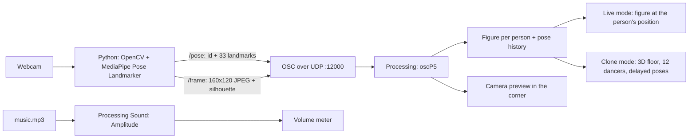

# Architecture

## Data flow
1. Python reads the webcam, mirrors the frame, and runs MediaPipe Pose Landmarker (up to 4 people).
2. Each person gets a stable ID through nearest-centroid matching between frames.
3. Python sends one `/pose` message per person and a small JPEG preview (`/frame`) every second frame.
4. Processing keeps one `Figure` per ID, with a short pose history used to replay movement with a delay.
5. Live mode draws the figure where the person stands; clone mode puts 12 randomized copies on a 3D dance floor.
